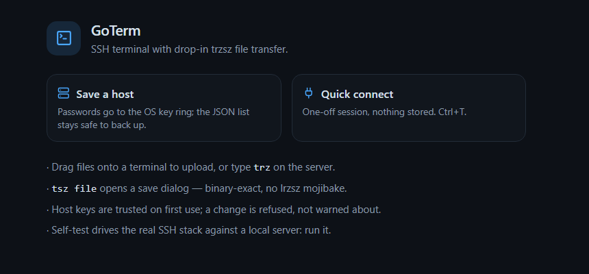

# GoTerm

**一个 Golang + [Wails v3](https://wails.io) + [xterm.js](https://xtermjs.org) 实现的桌面SSH终端：**
- `rz`/`sz`友好： 默认使用[`trz`/`tsz`](https://github.com/trzsz/trzsz.js) 传输文件，并兼容只有lrzsz的 `rz`/`sz`（ZMODEM）;
- ssh会话保活：支持长达24h的ssh会话保活(可设置)；
- ssh会话复制：需要多个ssh连接时，在标签页上右键`Duplicate`即可；
- 内置多种常规文档的关键字高亮；
- 完整功能[跳转到“能干什么”](#能干什么)



[English](README.md) · **简体中文** · [需求台账](plan.md) · [实现与决策记录](docs/DECISIONS.md)

---

## 🤖 让 AI 接着开发

**这个仓库就是按"可以交给 AI 继续写"来维护的。** [`plan.md`](plan.md) 是接口：
它是一本需求台账——用户提过什么、现在到哪一步、哪些红线永远不能碰、还剩什么没做、改完怎么验证。

把仓库交给任意 AI 编程助手时，只需要一句话：

> 读取 `plan.md`，按里面的台账继续开发，修复/优化/新增xx功能，做完跑测试并更新台账。

---

## 能干什么

**终端**
- 真 SSH：密码、私钥（口令在连接时弹窗问）、ssh-agent。
- 多标签，每个标签有自己的 xterm、SSH 会话和传输过滤器；拖拽调整顺序。*Duplicate* 在**同一条连接**上
  再开一个 shell，不做第二次登录。
- GPU（WebGL）渲染，失败自动回退 DOM。
- `Ctrl+Shift+F` 在本标签内搜索（`@xterm/addon-search`），计数是**缓冲区**的真实匹配数，不是屏幕上看得到的。
- 选中即复制（只在松手时触发）、多行粘贴先弹可编辑确认框。
- 远端编码：UTF-8（默认）或 GB18030 / GBK / GB2312 / Big5 / Shift_JIS，流式解码——一个汉字被 64 KiB
  输出块切开也不会变成两个替换字符。

**文件传输**
- 原生 `trz`/`tsz`，带 trzsz 自己的进度条；文件拖进终端即上传。
- 只有 lrzsz 的服务器也能用 `rz`/`sz`，而且画的是**同一行进度**（上游 trzsz 的 `TextProgressBar`，
  原样 vendor）直接画在终端里。
- 写盘路径限制在你这次真正选中的目录内。
- 取消是静默的：不抛协议异常，也不会把半截文件当成传完了。

**主机与凭据**
- 主机列表、分组、搜索、跳板机（`ssh -J` 单跳）、双因子（动态口令接在密码后，JumpServer 那种）。
- 主机密钥首次信任，之后变了就拒连；*Known hosts* 面板可以 forget。
- 密码存 Windows 凭据管理器（纯 syscall，不闪控制台窗口）；没有系统密钥环的平台回退密封文件。
  **任何密钥都不会进 webview。**
- 导出/导入：主机连同密码装进一个不透明文件——scrypt + AES-256-GCM。

**保持连接**
- SSH 保活（`keepalive@openssh.com`）——**绝不发回车**，所以不可能让对面提前执行什么。
- anti-idle 对付 `TMOUT` 和堡垒机活动检测，默认关闭：空格+退格（不可见）、空行，或者给 TUI 用的
  "只发一个空格"。
- **每条连接都有硬上限**（默认 12 小时，可设 1–24 小时，在 Go 侧执行）。保活是"发现链接已经死了"，
  不是"让一个登录永不结束"。

**其它**
- 明暗两套主题，窗口标题栏与边框跟着主题走（DWM）。关键字高亮支持"一行一套词汇"和 `.msyn` 导入，
  内置五套规则。
- 设置改动即时作用于所有已开标签，并持久化。
- 配置文件默认路径：%USERPROFILE%\AppData\Roaming\goterm（设置 → Behaviour → Storage 可改）;

---

## 安装

从仓库的 [**Releases**](https://github.com/ykfq/goterm/releases) 页面下载
`goterm-v1.0.0-windows-x64.exe` 和对应的 `.md5` / `.sha256`。那里的二进制是 GitHub Actions 根据 tag
构建的（[`.github/workflows/release.yml`](.github/workflows/release.yml)），不放进代码仓库。

**单文件便携版**，没有安装包。WebView2（Wails 内嵌的浏览器引擎）在 Windows 10/11 上是自带的；
Windows Server 或 LTSC 镜像可能需要先装一次 WebView2 Runtime。exe 放哪都能跑，状态写在
`%APPDATA%\goterm`（可用 `GOTERM_DIR` 改）。

要求：**Windows 10/11 或 Windows Server，x64**。这是 Windows 应用；Wails 工程本身能编 macOS/Linux，
但只有 Windows 这条路径被真正验证过。

## 从源码构建

```powershell
# 前置：Go >= 1.26、Node >= 20、Wails v3 CLI。
# 必须是 Go 1.26 而不是 1.25：wails3 v3.0.0 声明了 `go 1.26.0`。
go install github.com/wailsapp/wails/v3/cmd/wails3@latest

git clone https://github.com/ykfq/goterm
cd goterm
wails3 build          # 前端依赖 + bindings + vite 打包 + 二进制 -> bin\goterm.exe
```

网络受限时可以用 Go 模块镜像：`go env -w GOPROXY=https://goproxy.cn,direct`。找不到 `wails3` 时，把 Go 的 bin 目录加进 `PATH`。

改了被绑定的方法后要重新生成 TypeScript bindings：

```powershell
wails3 generate bindings -ts -d frontend/bindings -clean
```

`wails3 dev` 会起 Vite 并热重载 webview；只想看界面就在 `frontend/` 里 `npm run dev`
（它会提示 "No Go backend"，因为没有桥）。

## 测试

```powershell
go test ./...                        # Go：SSH 栈、主机存储、密钥、应用绑定
npm --prefix frontend test           # 373 个 vitest 用例 / 38 个文件
npm --prefix frontend run typecheck  # vue-tsc，严格模式
```

`internal/sshtest` 是被 Go 测试使用的**真 SSH 服务器**，`cmd/sshtest` 把它单独暴露出来，方便不碰真主机：

```powershell
go build -o build\bin\sshtest.exe .\cmd\sshtest
.\build\bin\sshtest.exe -addr 127.0.0.1:2222 -hostkey "$env:TEMP\sshtest_key.pem"
# 在 GoTerm 里连 127.0.0.1:2222，账号 tester / goterm-dev
#   -2fa                密码认证还要求末尾跟一个动态口令
#   -allow-forwarding   这台服务器可以当跳板机（direct-tcpip）
#   -shell trzsz        提供 tsz/trz 传输
```

GUI 冒烟脚本用合成的鼠标键盘去驱动真正的 `bin\goterm.exe`，所以**必须在真实桌面会话里跑**——
后台 shell 里什么也落不下去，截图只会拍到欢迎页：

```powershell
.\tools\gui-demo.ps1           # -> build\gui-dialog.png、gui-session.png、gui-typed.png
.\tools\gui-check.ps1          # 窗口能不能渲染
.\tools\frame-check.ps1        # 问 DWM 窗口边框到底是什么颜色
.\tools\gui-transfer.ps1 -Direction download   # 跑一场真的 tsz/trz 传输并逐字节校验
```

这些截图**故意不入库**（`.gitignore` 里挡掉了）：一张截图会连带桌面或屏幕水印策略打上去的东西一起进仓库。
仓库里只有一张精选图 `docs/screenshot.png`。

---

## 键盘与鼠标

| 操作 | 按键 |
| --- | --- |
| 复制选中 | `Ctrl+Shift+C` |
| 粘贴 | `Ctrl+Shift+V` |
| 在本标签内查找 | `Ctrl+Shift+F`，或右键 → *Find in terminal…* |
| 快速连接 | `Ctrl+Shift+T`（焦点不在终端时 `Ctrl+T` 也行） |
| 关闭标签 | `Ctrl+Shift+W`（焦点不在终端时 `Ctrl+W`），或中键点标签 |
| 折叠侧栏 | `Ctrl+Shift+B`（焦点不在终端时 `Ctrl+B`） |
| 清屏 | `Ctrl+Shift+K`（焦点不在终端时 `Ctrl+K`） |
| 下一个 / 上一个标签 | `Ctrl+Tab` / `Ctrl+Shift+Tab` |
| 字号 | `Ctrl+=`、`Ctrl+-`、`Ctrl+0`，或 `Ctrl+滚轮` |
| 右键菜单 / 标签菜单 | 右键终端 / 右键标签 |
| 设置 | `Ctrl+,` |

**有些控制键属于 shell，不属于应用。** 焦点在终端里时，`Ctrl+W` 是删词、`Ctrl+K` 是删到行尾、
`Ctrl+T` 是交换字符、`Ctrl+B` 是 tmux 前缀、`Ctrl+F` 是 readline 的前移一个字符——所以应用的命令放在
`Ctrl+Shift+…` 上，而未加 Shift 的组合在焦点位于侧栏或对话框时仍然有效。（这不是客气：以前 `Ctrl+W`
既关标签又删词，三个手误就把会话弄没了。）

**当全屏程序接管鼠标时**（`htop`、`tmux`）：右键归程序（它自己画菜单），`Shift+右键` 才是 GoTerm 的菜单；
`Shift+拖选` 在本地选词，松手照样进剪贴板；`Ctrl+滚轮` 仍然缩放。

**粘贴多行**会先弹一个可编辑的确认框——一整段文本就是一份没人读过的脚本。单行（带不带换行都行）
直接进 shell。

## 设置里值得知道的几项

| 分组 | 内容 |
| --- | --- |
| Appearance | 终端字体（只列等宽，GDI 枚举）、**块字符**、**远端文本编码**、终端背景色（六个预设或任意取色） |
| Behaviour | 单词分隔符（实时预览双击会选中哪一段）、选中即复制、**Idle sessions**（anti-idle 与 nudge 方式）、**会话最长时长**（1–24 小时）、**Storage**（文件放在哪） |
| Highlighting | 五套内置关键字规则、自定义关键字/正则+颜色、`.msyn` 导入 |

明暗主题是状态栏上的太阳/月亮图标；字号用 `Ctrl+=` / `Ctrl+-` / `Ctrl+0`。

**块字符**这一项决定 `█`、`│`、`─` 由谁画：xterm（铺满整格，会把 `dust` 的柱状图糊成一整块）还是
字体（保留行距，但 TUI 的边框可能出现发丝缝）。默认关；两种效果都截在图里，取舍写在
[`docs/DECISIONS.md`](docs/DECISIONS.md) —— xterm 只提供这一个开关，没有第三条路。

设置改动即时作用于所有已开标签并持久化；设置面板切页只是显示/隐藏，所以写了一半的自定义规则不会丢。

**Storage** 这一项显示主机列表、主机密钥指纹与密封密钥所在目录，可以换到别的盘。换目录**下次启动才生效**，
而且 GoTerm 不会替你搬文件：旧目录里的东西留在原地，新目录就当空的开始。环境变量 `GOTERM_DIR` 一旦设置
就永远优先（便携用法就是靠它把状态目录指到 exe 旁边）。

## 磁盘上的状态

设置 → Storage 里显示的那个目录（默认 `%APPDATA%\goterm`，或 `$XDG_CONFIG_HOME/goterm`）：

| 文件 | 内容 |
| --- | --- |
| `hosts.json` | 保存的主机，**不含任何密码** |
| `known_hosts.json` | 钉住的主机指纹 |
| `prefs.json` | 自定义状态目录的指针，永远留在默认目录里 |
| `secrets.enc` + `master.key` | 只有使用密封文件后端时才有 |

凭据管理器里的条目是通用凭据，名字为 `goterm/host/<id>/secret`。

---

## 代码怎么摆

```
main.go, app.go      Wails 应用与被绑定的方法（很薄：每个方法都只有几行）
files.go             原生文件选择器与受限的文件桥
selftest.go          应用内自检，对 internal/sshtest 跑真实协议栈
cmd/sshtest          给开发与测试用的真 SSH 服务器
internal/sshx        SSH：连接、认证、主机密钥、保活、跳板机、会话、时长上限
internal/hoststore   hosts.json、导出导入、给前端看的错误标记
internal/secrets     Windows 凭据管理器、密封文件回退
internal/appdir      状态目录怎么定：GOTERM_DIR > 设置里的指针 > 默认目录
internal/{appdir,atomicfile,hostport,fonts,wintheme,sshtest,testutil}

frontend/src/lib/
  terminal.ts    字节管道：base64 进来、有序写进 xterm，外加 anti-idle、查找、编码
  bytes.ts       base64 / UTF-8 / latin1 —— 整个编码问题都在这里
  zmodem.ts      lrzsz 扫描与传输，驱动 vendor 来的进度条
  store.ts       应用状态：标签、通知、设置、连接状态机
frontend/src/vendor/trzsz/progress.ts   trzsz 的进度条，原样 vendor
frontend/src/components/                Vue 3 + Tailwind 4
```

`app.go` 只做绑定；`internal/**` 不 import Wails；依赖单向（`main → hoststore → sshx / secrets`）。
完整设计说明（包括试了好几轮才定下来的部分）在 [`docs/DECISIONS.md`](docs/DECISIONS.md)。

## 已知限制

- **远端**仍然需要 `trz`/`tsz`（`pip install trzsz`，或把单文件扔进 `/usr/local/bin`）或 `lrzsz`。
  GoTerm 只会说这些协议，装不了它们。
- 跳板机是单跳（`ssh -J` 风格，不支持 `-J a,b`），且堡垒机必须允许 TCP 转发。
- 双因子是"动态口令接在密码后面"那种；没有独立的 keyboard-interactive 挑战，也不在 GoTerm 里生成 TOTP。
- anti-idle 对付只认"完整一行"的计时器要选空行模式；"只发一个空格"是唯一能进 TUI 的，代价是
  它会留在输入框里。
- 会话硬上限到点就是断：默认 12 小时（或你设的值），并说明原因。
- 换存储目录是下次启动生效，而且 GoTerm 不会替你搬文件。
- 保活能证明链路活着，但检测不出"TCP 还答但服务端已经僵住"的情况（无回应的探测约 45 秒 × 3 后被判定）。
- 没有安装包（NSIS）、没有端口转发、不解析 `~/.ssh/config`、没有会话日志、没有每主机 profile。
  Linux/macOS 构建未验证，字体列表是内置的短名单。
- 输出按你选的编码解码；**输入永远按 UTF-8 发送**（浏览器没有 GBK 编码器）。远端只认 GBK 时，
  在远端 `export LANG=zh_CN.UTF-8`。

## 许可证

[Apache License 2.0](LICENSE) © GoTerm contributors。第三方声明见 [NOTICE](NOTICE)：捆绑的代码保留各自许可证——Wails、xterm.js、Vue、
trzsz、zmodem.js、lucide；vendor 进来的文件保留原始版权头。
